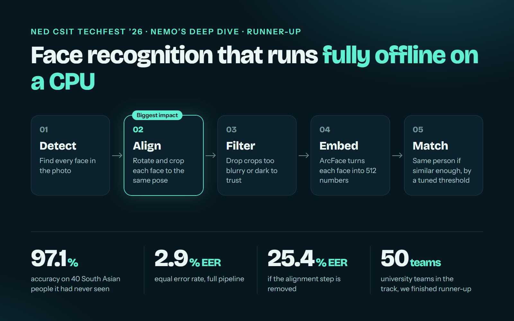
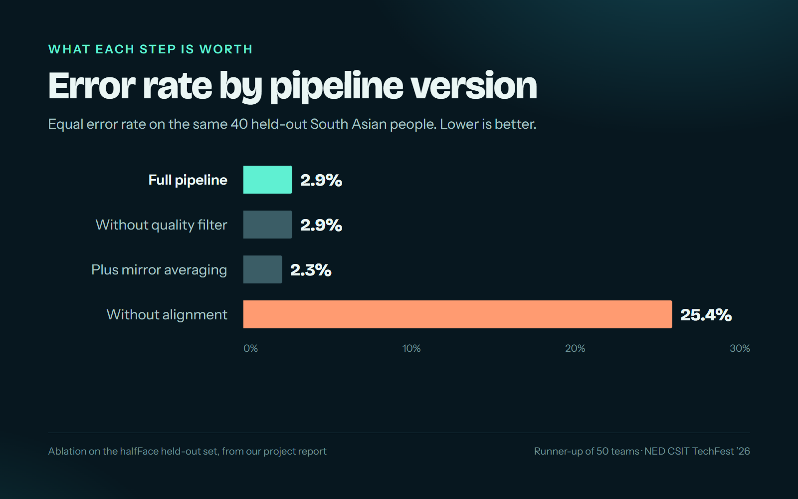
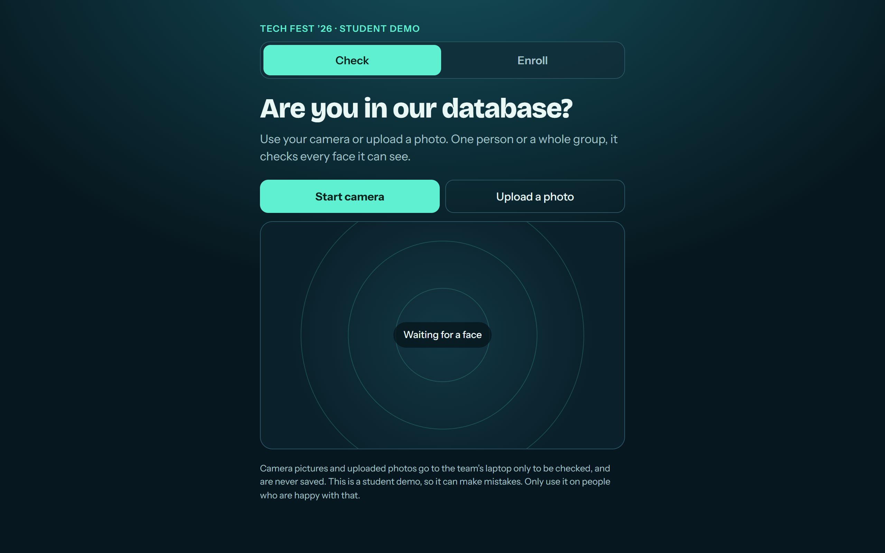

# Face recognition for Pakistani faces

Runner-up out of 50 university teams in Nemo's Deep Dive, the computer vision track of AI Odyssey at NED CSIT TechFest '26 (Round 2: "Every Fish Has a Face").

The system detects every face in a photo, straightens it, and decides who it is: either "same person or not" for two photos, or a name (or "Unknown") against a list of people who chose to be enrolled. It runs fully offline on a normal laptop CPU and never crashes on a photo with no face in it.



## How it works

| Step | What happens |
|---|---|
| 1. Detect | SCRFD-10G finds every face and 5 landmarks (eyes, nose, mouth corners) |
| 2. Align | Each face is rotated and cropped to the same 112 x 112 pose |
| 3. Filter | Crops that are too blurry, dark or small are dropped |
| 4. Embed | ArcFace (ResNet-50) turns each face into 512 numbers |
| 5. Match | Cosine similarity against a threshold picked on validation data |

The model itself is never retrained per person. Someone is "remembered" by storing their embeddings, so adding a person takes seconds.

## Results

Measured on people the model never saw during any tuning. Thresholds were picked on separate validation people.

| Test set | Accuracy | Equal error rate (EER) | AUC |
|---|---|---|---|
| halfFace, 40 held-out South Asian people | 97.1% | 2.9% | 0.991 |
| IMFDB, 24 held-out actors (movie frames, hard light and pose) | 87.5% | 10.5% | 0.955 |
| 13 Pakistani public figures (Wikimedia photos) | 99.2% | not measured | 1.000 |

On halfFace, unmasked faces scored 98.2% and masked faces 94.3%.



Alignment matters most. Removing it raises the error from 2.9% to 25.4%.

Fine-tuning didn't clearly help. We fine-tuned ArcFace on about 2,900 photos of 159 people on a cloud GPU. It did a little better on masked faces and movie frames, and a little worse on clean photos, so we kept the original model. Every number, including the negative results, is in [docs/RESULTS.md](docs/RESULTS.md), and the full report is [docs/Face_Recognition_Report.pdf](docs/Face_Recognition_Report.pdf). Design choices and their reasons are in [docs/DECISIONS.md](docs/DECISIONS.md).

## Live demo



`demo/collect.py` serves a small web page that anyone holding the link can open on a phone or laptop. It has two tabs:

- Check: your camera or an uploaded photo. Every face gets a name or "Unknown". Pictures are checked and never saved.
- Enroll: turn your head and the page takes a few photos on its own. Nobody is added until the team approves the request on a separate private page.

The link isn't permanently online, because it runs on a team member's laptop. Ask the team for a demo.

## Run it yourself

Tested with Python 3.12.

```
python -m venv .venv
.venv\Scripts\activate            # Linux or Mac: . .venv/bin/activate
pip install -r requirements.txt
```

The face models aren't stored in this repo. Download InsightFace `buffalo_l` (https://github.com/deepinsight/insightface/releases/download/v0.7/buffalo_l.zip) and unzip it into `models/buffalo_l/`.

```
python run.py verify --a photo1.jpg --b photo2.jpg                 # same person or not, with a score
python gallery.py enroll --name "Ali Khan" --images photos/ali --consent
python gallery.py identify --images group.jpg --save out/          # names or "Unknown" on every face
python gallery.py remove --name "Ali Khan"                         # erase a person
python live.py --source 0                                          # webcam page at http://127.0.0.1:8000
```

Demo pages: `pip install -r demo/requirements.txt`, then `python demo/collect.py` (live check and enroll page) or `python demo/app.py` (puts names on faces in a video file).

## What's in the repo

| Path | What it is |
|---|---|
| `pipeline.py` | The pipeline. Each stage can be switched off to measure what it's worth |
| `evaluate.py`, `evalkit.py` | Accuracy, precision, recall, F1, ROC, FAR/FRR, EER, results by group, ablation |
| `run.py` | Command-line entry point used for the competition benchmark |
| `gallery.py`, `live.py` | Enroll people and recognise them in photos, videos or a webcam |
| `augment.py` | Synthetic masks, hijab, dupatta, cap, turban, beard, blur and CCTV-style damage for training |
| `finetune.py`, `build_ft_data.py`, `build_imfdb.py` | The fine-tuning experiment and its data split |
| `collect_wikimedia.py`, `process_wikimedia.py` | Builds the small Pakistani test set from free-licence Wikipedia photos |
| `submission/` | The script used on competition day |
| `demo/` | Live web demo and video maker |
| `tools/` | Cloud GPU job, bootstrap tests, identification benchmark |
| `data/` | Split lists only (who is in which split). No face images |
| `results/` | Raw result files and charts |
| `docs/` | Report, all numbers, design decisions, data sources |

## Data and licences

- halfFace (Mendeley pk44mkx9vm, CC BY 4.0): 166 South Asian people, masked and unmasked. A South Asian stand-in, not a Pakistani-only set.
- IMFDB (IIIT Hyderabad): Indian film actors. The website states no licence, so the photos stay local. Only the list of who is in which split is in this repo.
- Wikimedia: free-licence photos of Pakistani public figures, used only as an unseen test. A free licence is not the person's consent, so these photos are not published here.

More detail is in [docs/DATA.md](docs/DATA.md).

## License

The code is under the [MIT License](LICENSE). The InsightFace `buffalo_l` models (SCRFD and ArcFace) are licensed separately, for non-commercial research only. This is a student project, not a product. Don't use it to identify people who haven't agreed to it.

## Team

- Maaz Rehman ([@maazrehman99](https://github.com/maazrehman99))
- Shaikh Muhammad Zain ([@ZainDev04](https://github.com/ZainDev04))
- Syed Mohammad Huzaifa ([@huzaifaguru](https://github.com/huzaifaguru))
